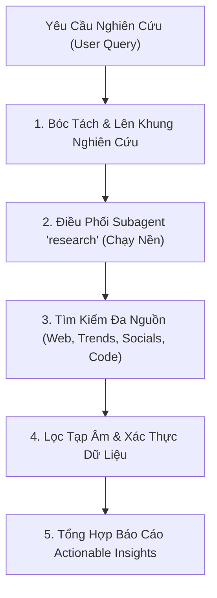

# 🌐 Agent-Reach: Deep Research & Market Intelligence

Bộ kỹ năng kích hoạt năng lực nghiên cứu sâu (Deep Web Research & Trend Scouting), tổng hợp dữ liệu từ internet, mạng xã hội và phân tích đối thủ cạnh tranh dành riêng cho Creative Designers & Marketers.

---

## 🧭 Cơ Chế Vận Hành (Execution Flow)

Khi người dùng yêu cầu `@agent-reach` hoặc nhờ nghiên cứu một chủ đề:

### 1. Bóc tách câu hỏi nghiên cứu (Scope Deconstruction)
- Xác định mục tiêu: Nghiên cứu thị trường (Market), Đối thủ (Competitors), Xu hướng thị giác (Visual Trends), hay Kỹ thuật công nghệ (Tech Stack/Tools)?
- Thiết lập từ khóa tìm kiếm tiếng Anh & tiếng Việt để mở rộng phạm vi dữ liệu toàn cầu.

### 2. Kích hoạt Subagent `research`
Agent chính sẽ khởi chạy subagent `research` độc lập với mô tả nhiệm vụ rõ ràng:
- Tìm kiếm từ các nguồn uy tín: Pinterest Trends, Google Trends, Behance Curated, Reddit (r/printondemand, r/graphic_design), Product Hunt, TikTok Creative Center.
- Trích xuất số liệu, trường hợp thực tế (Case studies) và framework đã được kiểm chứng.

### 3. Cấu trúc Báo cáo Trả về (Standard Research Output)
Báo cáo trả về bắt buộc gồm 4 phần:
1. **Executive Summary (Tóm tắt cốt lõi trong 3 gạch đầu dòng)**.
2. **Key Findings & Data Points (Dữ liệu định lượng, nguồn dẫn chứng)**.
3. **Market Gaps / Opportunities (Cơ hội bứt phá cho Tiểu Ngọc)**.
4. **Actionable Next Steps (Hành động cụ thể có thể làm ngay)**.

---

## ⚡ Các Lệnh Mẫu Người Dùng Có Thể Gọi

Tiểu Ngọc có thể gọi trực tiếp:
- *"@agent-reach Hãy nghiên cứu các xu hướng thiết kế áo thun Streetwear đang viral nhất trên TikTok US tuần này."*
- *"@agent-reach Tìm cho mình 5 đối thủ POD anime nổi bật nhất trên Etsy/Shopify và phân tích cách họ làm mockup."*
- *"@agent-reach Nghiên cứu các studio thiết kế tại Đông Nam Á đang tuyển Senior Designer có kỹ năng AI."*
