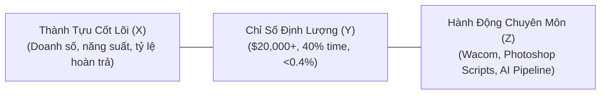

# 💼 Career Advancement & Recruiter Outreach

Bộ kỹ năng toàn diện hỗ trợ tìm kiếm cơ hội nghề nghiệp cao cấp, tối ưu hóa hồ sơ năng lực vượt qua các bộ lọc tự động (ATS & AI Screeners), và xây dựng chiến lược tiếp cận trực tiếp (Warm Outreach) tới các Design Leaders & Nhà tuyển dụng.

---

## 🎯 The Google XYZ Formula for Creative Impact

Thay vì mô tả chung chung các đầu việc thường ngày, toàn bộ kinh nghiệm và thành tích phải được chuyển hóa theo công thức chuẩn của Google:

$$\text{"Accomplished [X] as measured by [Y], by doing [Z]"}$$
*(Đạt được thành tựu [X], được đo lường bằng con số [Y], thông qua hành động cụ thể [Z])*



### Ví Dụ Chuyển Đổi Thực Tế (Dữ liệu của Tiểu Ngọc):
- ❌ **Cách viết cũ (yếu):** *"Thiết kế áo thun ngách anime cho thị trường Mỹ và làm việc với xưởng in."*
- ✅ **Chuẩn Google XYZ:** *"Chủ trì thiết kế bộ sưu tập thời trang Anime POD cán mốc **$20,000+ USD doanh thu** chỉ trong Q4/2025 thông qua việc kết hợp nét vẽ Wacom chi tiết cao và quy trình tách màu in DTG chuẩn 300 DPI."*

- ❌ **Cách viết cũ (yếu):** *"Tự động hóa công việc thiết kế bằng photoshop."*
- ✅ **Chuẩn Google XYZ:** *"Cắt giảm **~40% thời gian sản xuất** và ghép mockup hàng loạt cho 3500+ sản phẩm bằng cách tự lập trình các Photoshop Actions và JavaScript Scripts (ExtendScript)."*

---

## 📬 The 3-Tier Warm Outreach Sequence (Quy Trình Tiếp Cận Không Spam)

Chiến lược tiếp cận trực tiếp nhà tuyển dụng qua LinkedIn hoặc Email:

### Tier 1: Lời Mời Kết Nối (Dưới 300 ký tự - Connection Request)
> *"Chào anh/chị [Tên], em theo dõi các sản phẩm của [Tên công ty] và rất ấn tượng với phong cách hình ảnh của team. Em là Tiểu Ngọc, Senior Graphic Designer chuyên POD Âu-Mỹ kết hợp Wacom và tự động hóa AI/Scripting. Rất vui được kết nối để học hỏi từ anh/chị!"*

### Tier 2: Tin Nhắn Trực Tiếp / InMail (Dưới 150 từ - Giá trị đi trước)
> *"Chào anh/chị [Tên],  
> Em thấy [Tên công ty] đang mở rộng quy mô dòng sản phẩm thời trang / e-commerce.  
> Với hơn 4 năm kinh nghiệm thiết kế 3500+ sản phẩm POD cho thị trường US/EU và xây dựng quy trình tự động hóa giúp giảm 40% thời gian xuất file in, em tin mình có thể hỗ trợ team tăng tốc độ ra mắt bộ sưu tập mới mà vẫn giữ trọn chất lượng in ấn chuẩn xưởng.  
> Anh/chị có thể xem nhanh các case study và quy trình thực tế của em tại: **tieungoc.site**  
> Nếu anh/chị thấy phù hợp, em rất vui được dành 10–15 phút trao đổi ngắn cùng team vào tuần tới ạ!"*

### Tier 3: Tin Nhắn Nhắc Nhẹ Kèm Tài Nguyên (Follow-up sau 4–5 ngày)
> *"Chào anh/chị [Tên], em gửi tặng anh/chị bảng checklist kiểm tra file in ấn DTG 300 DPI chống lỗi bệt màu mà em thường áp dụng cho các bộ sưu tập xuất khẩu. Chúc anh/chị và team một tuần làm việc hiệu quả nhé!"*

---

## ⚡ Battle-Tested Prompt Templates

### Template 1: Phân Tích JD và Viết Lại CV Bằng Công Thức Google XYZ
```text
Act as an Executive Creative Recruiter and ATS Optimization Specialist.

I am applying for the role of: [TÊN VỊ TRÍ, VÍ DỤ: Senior Visual Designer / AI Design Lead]
Target Company: [TÊN CÔNG TY]
Job Description (JD):
[DÁN BẢNG MÔ TẢ CÔNG VIỆC TẠI ĐÂY]

My Background:
- 4+ years as Graphic Designer at Vani Ecommerce (US/EU POD market)
- Designed 3,500+ SKUs (apparel, mugs, posters)
- Anime POD Collection generated $20,000+ in Q4
- Programmed Photoshop Actions & JS Scripts reducing production time by 40%
- Wacom illustration, CMYK/DTG print expertise (<0.4% return rate)
- Klaviyo email marketing with 28% open rate

Tasks:
1. Extract top 8 ATS keywords and core competencies from the JD.
2. Rewrite my work experience bullets matching this JD using the Google XYZ formula: "Accomplished [X] as measured by [Y], by doing [Z]".
3. Generate a personalized 150-word cover letter opening pitch.
```

### Template 2: Tạo Kịch Bản Phỏng Vấn Về Quy Trình AI & Tự Động Hóa
```text
Act as a Creative Director interviewing me for a Senior Graphic Designer position that values AI integration and automation.

Ask me 3 tough technical interview questions regarding:
1. How I balance human artistic intuition (Wacom) with AI speed without creating "AI slop".
2. How I handle color profile management (CMYK vs RGB) and avoid DTG print errors.
3. How I designed and deployed my Photoshop automation scripts.

For each question, provide a recommended high-impact response structure based on my background at Vani Ecommerce.
```

---

## 📋 Checklist Ứng Tuyển & Săn Việc
- [ ] Bảng mô tả công việc (JD) đã được giải phẫu thành các từ khóa then chốt.
- [ ] Mọi thành tích trong CV đều có con số định lượng ($, %, thời gian).
- [ ] Hồ sơ LinkedIn có Headline rõ ràng và link dẫn về portfolio `tieungoc.site`.
- [ ] Tin nhắn kết nối gửi tới Recruiter mang tính cá nhân hóa, không sao chép mẫu công nghiệp.
- [ ] Chuẩn bị sẵn portfolio live demo trên `tieungoc.site` để chia sẻ màn hình khi phỏng vấn.
