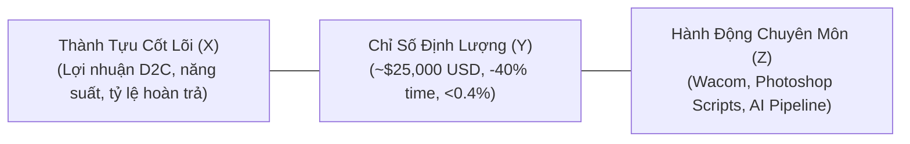

# 💼 Career Advancement & Recruiter Outreach

Bộ kỹ năng toàn diện hỗ trợ tìm kiếm cơ hội nghề nghiệp cao cấp, tối ưu hóa hồ sơ năng lực vượt qua các bộ lọc tự động (ATS & AI Screeners), và xây dựng chiến lược tiếp cận trực tiếp (Warm Outreach) tới các Design Leaders & Nhà tuyển dụng.

---

## 🎯 The Google XYZ Formula for Creative Impact

Thay vì mô tả chung chung các đầu việc thường ngày, toàn bộ kinh nghiệm và thành tích phải được chuyển hóa theo công thức chuẩn của Google:

$$\text{"Accomplished [X] as measured by [Y], by doing [Z]"}$$
*(Đạt được thành tựu [X], được đo lường bằng con số [Y], thông qua hành động cụ thể [Z])*



### Ví Dụ Chuyển Đổi Thực Tế (Dữ liệu của Tiểu Ngọc):
- ❌ **Cách viết cũ (yếu):** *"Thiết kế áo thun và banner cho thị trường Mỹ và làm việc với xưởng in."*
- ✅ **Chuẩn Google XYZ:** *"Phụ trách toàn bộ thiết kế sản phẩm in ấn và visual quảng cáo cho 3 thương hiệu E-commerce (D2C), đóng góp vào kết quả **~$25,000 USD lợi nhuận của team D2C trong Q4/2025** thông qua việc kết hợp nét vẽ Wacom chi tiết cao, AI có chọn lọc và quy trình tách màu in chuẩn 300 DPI."*

- ❌ **Cách viết cũ (yếu):** *"Tự động hóa công việc thiết kế bằng photoshop."*
- ✅ **Chuẩn Google XYZ:** *"Cắt giảm **~40% thời gian sản xuất** và **99% lỗi đặt tên file theo SKU** cho hơn **5,000+ sản phẩm in ấn** bằng cách tự xây dựng hệ thống Photoshop Actions (`.atn`) và JavaScript Scripts (`.jsx`)."*

---

## 📬 The 3-Tier Warm Outreach Sequence (Quy Trình Tiếp Cận Không Spam)

Chiến lược tiếp cận trực tiếp nhà tuyển dụng qua LinkedIn hoặc Email:

### Tier 1: Lời Mời Kết Nối (Dưới 300 ký tự - Connection Request)
> *"Chào anh/chị [Tên], em theo dõi các sản phẩm của [Tên công ty] và rất ấn tượng với phong cách hình ảnh của team. Em là Tiểu Ngọc, Senior Graphic Designer chuyên E-commerce & POD (5,000+ sản phẩm) kết hợp AI và tự động hóa Photoshop. Rất vui được kết nối cùng anh/chị ạ!"*

### Tier 2: Tin Nhắn Trực Tiếp / InMail (Dưới 150 từ - Giá trị đi trước)
> *"Chào anh/chị [Tên],  
> Em thấy [Tên công ty] đang tuyển vị trí [Tên vị trí] để mở rộng quy mô hình ảnh E-commerce / Marketing.  
> Với hơn 4 năm kinh nghiệm thiết kế 5,000+ sản phẩm in ấn, banner quảng cáo Facebook/Google Ads cho thị trường US/EU (đóng góp ~$25,000 USD lợi nhuận team D2C trong Q4/2025) và tự viết Photoshop Scripts giúp giảm 40% thời gian sản xuất, em tin mình có thể hỗ trợ team tăng tốc độ ra mắt ấn phẩm mới mà vẫn giữ trọn chất lượng chuẩn chỉ.  
> Anh/chị có thể xem nhanh các case study và quy trình thực tế của em tại: **tieungoc.site**  
> Nếu anh/chị thấy phù hợp, em rất vui được gửi CV chi tiết và trao đổi thêm cùng team ạ!"*

### Tier 3: Tin Nhắn Nhắc Nhẹ Kèm Tài Nguyên (Follow-up sau 4–5 ngày)
> *"Chào anh/chị [Tên], em gửi tặng anh/chị bảng checklist kiểm tra file in ấn 300 DPI & quy trình tự động hóa xuất banner/mockup hàng loạt bằng Photoshop Actions mà em thường áp dụng. Chúc anh/chị và team một tuần làm việc hiệu quả nhé!"*

---

## ⚡ Battle-Tested Prompt Templates

### Template 1: Phân Tích JD và Viết Lại CV Bằng Công Thức Google XYZ
```text
Act as an Executive Creative Recruiter and ATS Optimization Specialist.

I am applying for the role of: [TÊN VỊ TRÍ, VÍ DỤ: Senior Graphic Designer / E-commerce Designer]
Target Company: [TÊN CÔNG TY]
Job Description (JD):
[DÁN BẢNG MÔ TẢ CÔNG VIỆC TẠI ĐÂY]

My Background:
- 4+ years as Senior Graphic Designer at Vani Ecommerce (US/EU E-commerce & POD market)
- Designed 5,000+ print products, Facebook/Google Ads banners, website banners & 2D/3D mockups
- Owned all visuals for D2C Project (3 E-commerce brands), contributing to ~$25,000 USD D2C team profit in Q4/2025
- Built Photoshop Actions (.atn) & JS Scripts (.jsx) reducing production time by 40% and SKU naming errors by 99%
- Wacom illustration, CMYK/RGB 300 DPI print QC (<0.4% return rate)
- Klaviyo email marketing visuals with 28% open rate
- Tagline: "Dùng AI có gu, tạo sản phẩm có hồn, không rập khuôn. — AI with taste, design with soul. Never AI slop."

Tasks:
1. Extract top 8 ATS keywords and core competencies from the JD.
2. Rewrite my work experience bullets matching this JD using the Google XYZ formula: "Accomplished [X] as measured by [Y], by doing [Z]".
3. Generate a personalized 150-word cover letter opening pitch.
```

### Template 2: Tạo Kịch Bản Phỏng Vấn Về Quy Trình AI & Tự Động Hóa
```text
Act as a Creative Director interviewing me for a Senior Graphic Designer position that values AI integration and automation.

Ask me 3 tough technical interview questions regarding:
1. How I balance human artistic intuition (Wacom) with AI speed without creating "AI slop".
2. How I handle color profile management (CMYK vs RGB) and avoid DTG print errors.
3. How I designed and deployed my Photoshop automation scripts.

For each question, provide a recommended high-impact response structure based on my background at Vani Ecommerce.
```

---

## 📋 Checklist Ứng Tuyển & Săn Việc
- [ ] Bảng mô tả công việc (JD) đã được giải phẫu thành các từ khóa then chốt.
- [ ] Mọi thành tích trong CV đều có con số định lượng ($, %, thời gian).
- [ ] Hồ sơ LinkedIn có Headline rõ ràng và link dẫn về portfolio `tieungoc.site`.
- [ ] Tin nhắn kết nối gửi tới Recruiter mang tính cá nhân hóa, không sao chép mẫu công nghiệp.
- [ ] Chuẩn bị sẵn portfolio live demo trên `tieungoc.site` để chia sẻ màn hình khi phỏng vấn.
