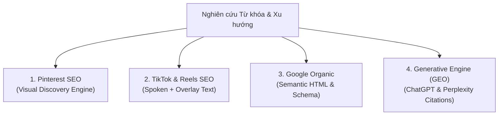

# 🔍 Creator SEO & GEO Researcher

Kỹ năng tối ưu hóa tìm kiếm đa phương thức (Multimodal Search) và Định hình nội dung cho Công cụ tìm kiếm AI (Generative Engine Optimization - GEO), giúp các tác phẩm, bài viết và portfolio của Designer tiếp cận đúng đối tượng mục tiêu.

---

## 🌐 The Multimodal Search Quad-Matrix



### 1. Pinterest SEO (Công Cụ Khám Phá Thị Giác Lớn Nhất)
- **Tỷ lệ chuẩn:** 2:3 (1000 x 1500px), độ tương phản cao, chữ to rõ ràng.
- **Vị trí đặt từ khóa:**
  - Tiêu đề Pin (Pin Title): Đưa từ khóa chính vào 30 ký tự đầu tiên.
  - Mô tả Pin (Pin Description): Chứa 2–3 từ khóa đuôi dài (long-tail keywords) và liên kết trực tiếp về bài viết/dự án trên `tieungoc.site`.
  - Tên Bảng (Board Title): Phân loại chuẩn theo ngách (ví dụ: *POD Apparel Concepts, Wacom Illustration Tips, Anime Streetwear Inspo*).

### 2. TikTok & Video SEO (Công Cụ Tìm Kiếm Video Thế Hệ Mới)
Thuật toán video quét và xếp hạng dựa trên 4 tín hiệu:
- **Lời thoại trong 3 giây đầu (Spoken Hook):** Bắt buộc phát âm rõ ràng từ khóa chính (ví dụ: *"Cách mình vẽ minh họa áo thun bằng Wacom..."*).
- **Chữ xuất hiện trên video (On-screen Text Overlay):** Khớp chính xác với cụm từ người dùng thường gõ tìm kiếm.
- **Caption & Hashtag:** Cấu trúc 3 tầng: 1 thẻ rộng (`#GraphicDesign`), 1 thẻ ngách (`#PrintOnDemand`), 1 thẻ cộng đồng (`#DesignerVietnam`).
- **Tên tệp video gốc:** Đổi tên file trước khi upload (ví dụ: `wacom-drawing-pod-design-tips.mp4` thay vì `IMG_1234.mov`).

### 3. Google Organic & On-Page SEO cho Portfolio
- Cấu trúc tiêu đề phân cấp rõ ràng: `<h1>` (tên dự án), `<h2>` (thử thách, giải pháp, kết quả), `<h3>` (công cụ & quy trình).
- Thẻ hình ảnh `alt`: Mô tả chính xác nội dung tác phẩm + từ khóa phong cách (ví dụ: `alt="Thiết kế áo thun phong cách Cyberpunk vẽ bằng bảng Wacom cho thị trường Mỹ"`).

### 4. Generative Engine Optimization (GEO - Tối ưu cho AI Search)
- Để các công cụ như Perplexity, ChatGPT Search, Gemini trích dẫn website `tieungoc.site`:
  - Cung cấp các số liệu định lượng chính xác (3500+ designs, Q4 $20K+ revenue, 40% time saved).
  - Trình bày dạng bảng so sánh và bullet points rõ ràng để AI crawler dễ trích xuất dữ liệu.
  - Sử dụng cấu trúc Schema.org (`Person`, `CreativeWork`, `Article`).

---

## ⚡ Battle-Tested Prompt Templates

### Template: Tạo Gói Metadata Đa Kênh Cho 1 Dự Án Hoặc Bài Viết
```text
Act as a Visual Search SEO Expert specializing in Pinterest, TikTok, and Generative Engine Optimization (GEO).

Project / Topic: [TÊN DỰ ÁN HOẶC CHỦ ĐỀ BÀI VIẾT]
Target Audience: Creative Directors, E-commerce Brand Owners, US/EU Apparel Buyers, Design Recruiters.

Please generate:
1. KEYWORD CLUSTERING TABLE: Group keywords into Informational, Commercial, and Transactional with search intent.
2. PINTEREST PIN OPTIMIZATION:
   - 3 Pin Titles (keyword-rich, max 60 chars)
   - 1 Pin Description (max 300 chars, embedding 3 high-intent keywords + CTA to tieungoc.site)
3. TIKTOK / REELS SEO BLUEPRINT:
   - Spoken Opening Hook (first 3 seconds with exact keyword)
   - 3 On-Screen Text Overlays
   - Caption with strategic 3-tier hashtag cluster (#broad #niche #community)
4. GEO SUMMARY SNIPPET: A 50-word structured entity summary formatted for AI Search citation.
```

---

## 📋 Checklist Vận Hành Nghiên Cứu & Đăng Tải
- [ ] Xác định mục đích tìm kiếm (Người xem muốn học cách làm hay muốn thuê thiết kế?).
- [ ] Kiểm tra từ khóa xu hướng trên Pinterest Trends hoặc Google Trends.
- [ ] Tối ưu hóa kích thước và tỷ lệ ảnh (2:3 cho Pinterest, 9:16 cho TikTok/Reels).
- [ ] Đặt tên file ảnh/video chứa từ khóa không dấu nối gạch ngang trước khi tải lên.
- [ ] Gắn link trỏ về website chính `tieungoc.site` để hứng trọn luồng truy cập tự nhiên.
