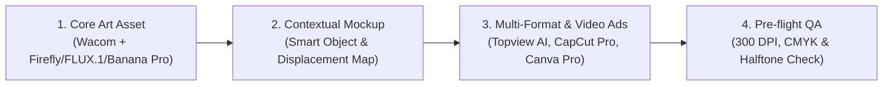

# 🎨 POD & E-Commerce Visual Campaign Architect

Quy trình chuẩn (SOP) giúp thiết kế, tạo sinh và tối ưu hóa các chiến dịch hình ảnh & video Marketing, POD (Print-on-Demand) và E-commerce đa kênh (Shopify, Meta Ads, TikTok, Klaviyo Email) theo triết lý **Human-Crafted, AI-Accelerated**.

---

## 🚀 The 4-Pillar Visual Pipeline



### Pillar 1: Khởi tạo Artwork Cốt Lõi (Core Art Asset — 30% AI Trợ lực, 70% Con người Quyết định)
- **Công cụ:** Bảng vẽ Wacom kết hợp AI Generative (Adobe Firefly, Photoshop Generative Fill, FLUX.1, Banana Pro) & AI Upscaling (Topaz / Magnific / Upscayl).
- **Triết lý cốt lõi:** Con người có gu thẩm mỹ riêng cho từng insight khách hàng và hiểu góc nhìn của con người sâu sắc hơn AI. Dùng AI để thử nghiệm ánh sáng/chất liệu nhanh, nhưng vẽ tay bằng Wacom để giữ hồn nhân vật và tinh chỉnh Typography độc bản.
- **Yêu cầu kỹ thuật:** File vẽ tối thiểu 4500x5400px (cho in áo thun DTG), độ phân giải 300 DPI, nền trong suốt (transparent background).
- **Kỹ thuật tách layer:** Giữ riêng biệt các layer: Line-art, Base Color, Shadow/Highlight, Typography.

### Pillar 2: Phối Cảnh & Ghép Mockup Sản Phẩm (Contextual Mockup)
- **Công cụ:** Adobe Photoshop Smart Objects + Displacement Map + ExtendScript (.jsx).
- **Tạo chiều sâu tự nhiên:** Sử dụng bản đồ dịch chuyển (Displacement Map) của mặt vải để hình in uốn lượn mềm mại theo từng nếp nhăn của áo thun/hoodie, không bị phẳng lì như ảnh ghép rẻ tiền.
- **Hệ màu hiển thị:** RGB cho ảnh catalog online, kiểm tra gamut để màu không bị lệch khi khách xem trên màn hình điện thoại iPhone/Android.

### Pillar 3: Nhân Bản Đa Nền Tảng & Video Quảng Cáo (Multi-Format & Video Ads)
Tự động xuất 1 thiết kế thành trọn bộ ấn phẩm quảng cáo tĩnh và động (sử dụng **PS Scripts, Topview AI, CapCut Pro, Canva Pro**):
- **Hero Image / Product Catalog (1:1):** 2000x2000px, nền trắng hoặc studio tối giản.
- **Meta Ads Feed (4:5):** 1080x1350px, bố cục tập trung 1/3 phía trên cho sản phẩm chính.
- **TikTok / Instagram Reels Video Ads (9:16):** 1080x1920px, sản xuất nhanh video quảng cáo chuyển đổi cao bằng **Topview AI** kết hợp dựng hậu kỳ **CapCut Pro** & **Canva Pro**.
- **Klaviyo Email Newsletter Header:** 600x300px hoặc 600x400px, nén dưới 200KB để email load tức thì.

### Pillar 4: Kiểm Soát Chất Lượng Xưởng In (Pre-flight QA)
- Kiểm tra vùng an toàn (Safety Margin: cách mép áo tối thiểu 2 inches).
- Kiểm tra độ tương phản dải màu tối và tách lớp Halftone Underbase (Tránh hiện tượng bệt đen khi in DTG lên vải cotton 100%).
- Đảm bảo tỷ lệ hoàn trả do lỗi in dưới 0.4%.

---

## ⚡ Battle-Tested Prompt Templates

### 1. Adobe Firefly / Banana Pro Lifestyle Background (Tạo phông nền phong cách sống)
```text
A sun-drenched minimalist Scandinavian living room, neutral beige and warm earth tones, soft linen couch, monstera shadows casting on a clean white textured plaster wall, interior editorial photography, natural volumetric morning light, shot on 35mm lens, f/2.8, hyperrealistic
```

### 2. FLUX.1 Apparel Mockup with Typography (Tạo mockup áo cao cấp)
```text
Commercial product photography of a premium heavyweight washed black cotton oversized hoodie laid flat on industrial polished concrete. Centered on the chest is a bold, distressed vintage typography print reading "[SLOGAN]". Intricate fabric weave texture, realistic screen-printed ink cracking effect, soft studio lighting, high resolution e-commerce catalog shot.
```

### 3. Klaviyo Email Banner Layout (Thiết kế banner email tiếp thị)
```text
Design an editorial e-commerce newsletter banner layout (width 600px, height 350px) for an apparel drop. Dark mode aesthetic, elegant typography featuring "[COLLECTION NAME]", showcasing a mockup of [PRODUCT] on the right, high contrast, warm terracotta accent highlights, clear visual hierarchy leading the eye downward to the CTA button.
```

---

## 📋 Checklist Vận Hành Nhanh (Execution Checklist)

- [ ] Phân tích tệp khách hàng mục tiêu bằng sự thấu cảm con người (Niche, độ tuổi, sở thích văn hóa tại US/EU).
- [ ] Chọn công cụ AI phù hợp (Adobe Firefly / Generative Fill / Banana Pro cho mood & lighting, FLUX.1 cho chi tiết vật liệu, Topview AI & CapCut Pro cho video ads).
- [ ] Hoàn thiện nét vẽ Wacom thủ công & kiểm tra Smart Object / Displacement Map trong Photoshop để độ nhăn vải chân thật 100%.
- [ ] Chạy Photoshop Actions / Scripts xuất hàng loạt biến thể màu sắc (Black, White, Navy, Sand).
- [ ] Tối ưu hóa dung lượng (WebP/JPEG nén lossless) trước khi tải lên store hoặc chiến dịch quảng cáo.
