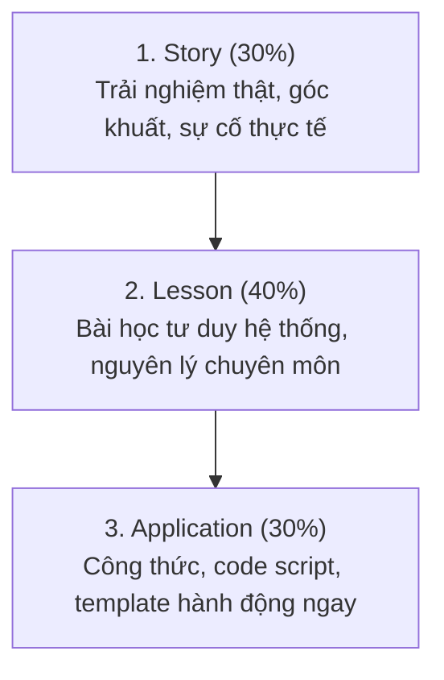

# ✍️ Thought Leadership Storyteller

Bộ kỹ năng giúp chuyển hóa các trải nghiệm thực chiến, bài học kỹ thuật và nhật ký làm nghề thành những bài viết chạm tới cảm xúc người đọc, xây dựng uy tín chuyên gia trên LinkedIn và Substack mà hoàn toàn không dính "văn phong AI sáo rỗng" (anti-AI slop).

---

## 🎯 The SLA Framework (Story – Lesson – Application)



### 1. Story (30%): Móc Nối Bằng Trải Nghiệm Thật
- Mở đầu bằng một tình huống thực chiến tại xưởng/studio: một file in bị lỗi màu, một đêm thức trắng sửa script Photoshop, hay cảm xúc overthinking của một cô gái Song Ngư trước deadline.
- Tuyệt đối tránh những câu mở đầu chung chung như *"In today's fast-paced digital era..."* hoặc *"Design is an ever-evolving landscape..."*.

### 2. Lesson (40%): Đúc Rút Quy Luật & Tư Duy Hệ Thống
- Chuyển hóa kinh nghiệm cá nhân thành góc nhìn chuyên gia: Tại sao việc tách layer lại quan trọng? Tại sao AI không thể thay thế con người ở khâu kiểm soát dải màu in? Tại sao designer cần học tư duy tự động hóa (DesignOps)?

### 3. Application (30%): Giải Pháp Thực Tế
- Cung cấp giá trị cụ thể mà người đọc có thể áp dụng được ngay: Một đoạn code ExtendScript ngắn, một checklist 4 bước kiểm tra file in, hoặc một công thức viết prompt Midjourney có cấu trúc.

---

## 🛡️ Anti-AI Slop Rules (Tiêu Chuẩn Chống Văn Phong AI)

Để đảm bảo bài viết luôn mang đậm bản sắc cá nhân và sự chân thực:

1. **Cấm tuyệt đối các từ ngữ sáo rỗng tiếng Anh:**  
   *`Delve`, `Testament`, `Beacon`, `Unleash`, `Tapestry`, `Game-changer`, `Pivotal`, `Synergy`*.
2. **Cấm các cụm từ dịch máy gượng gạo trong tiếng Việt:**  
   *`Trong thế giới ngày nay`, `Không thể phủ nhận rằng`, `Đóng vai trò then chốt`, `Là minh chứng cho`*.
3. **Nhịp điệu câu đan xen (Sentence Rhythm):**  
   Kết hợp giữa các câu ngắn dứt khoát (3–5 từ) để tạo nhịp điệu mạnh mẽ, và những câu dài giàu cảm xúc để chia sẻ tâm tư.
4. **Không gian thở thị giác (Visual Whitespace):**  
   Mỗi đoạn văn tối đa 1–2 câu trên LinkedIn. Dùng bullet points và ngắt dòng hợp lý để người đọc trên điện thoại không bị mỏi mắt.

---

## ⚡ Battle-Tested Prompt Templates

### Template 1: Biến Trải Nghiệm Thô Thành Bài Viết LinkedIn SLA
```text
Act as an elite personal branding strategist and digital storyteller for Trần Tiểu Ngọc (AI-First Graphic Designer & Creative Technologist). 

Transform the following raw work experience into a high-engagement LinkedIn post using the SLA Framework (Story -> Lesson -> Application).

Tone & Voice Guidelines:
- Warm, introspective (Pisces 2000s creator vibe), yet deeply technical and metrics-driven (SOPs, automation, Photoshop scripts, 3,500+ SKUs).
- Zero AI buzzwords (ban "delve", "game-changer", "testament", "unleash", "tapestry").
- Visual rhythm: Short, punchy paragraphs (1-2 sentences), strategic bullet points, plenty of whitespace.
- 100% natural Vietnamese, authentic Sài Gòn creative tone.

Raw Experience:
[DÁN NỘI DUNG TRẢI NGHIỆM TẠI ĐÂY]
```

### Template 2: 5 Kiểu Mở Đầu (Hook) Thu Hút Người Đọc
1. **Curiosity Hook:** *"Hầu hết designer đang làm mockup sản phẩm theo cách tốn thời gian nhất..."*
2. **Data/Proof Hook:** *"Cách một đoạn script 20 dòng giúp mình cắt giảm 40% thời gian render 3500 mẫu áo POD..."*
3. **Contrarian Hook:** *"AI không làm designer mất việc. Nó chỉ đào thải những ai lười xây dựng quy trình."*
4. **Story Hook:** *"Năm 2022, mình từng phát khóc vì 50 cái áo in ra bị xỉn màu hoàn toàn so với màn hình máy tính..."*
5. **Vulnerability Hook:** *"Là một Song Ngư hay overthinking, đây là cách mình biến tính cầu toàn thành lợi thế lớn nhất trong nghề thiết kế."*

---

## 📋 Checklist Biên Tập Trước Khi Đăng Bài
- [ ] Đoạn mở đầu có đủ gây tò mò trong 3 dòng đầu tiên (trước nút "Xem thêm / See more") không?
- [ ] Bài viết có chứa số liệu hoặc bằng chứng thực tế (3500+ designs, 40% time, 300 DPI, Q4 revenue) không?
- [ ] Đã quét sạch các từ ngữ AI sáo rỗng chưa?
- [ ] Cuối bài có câu hỏi mở (CTA) tự nhiên để mời gọi độc giả thảo luận không?
