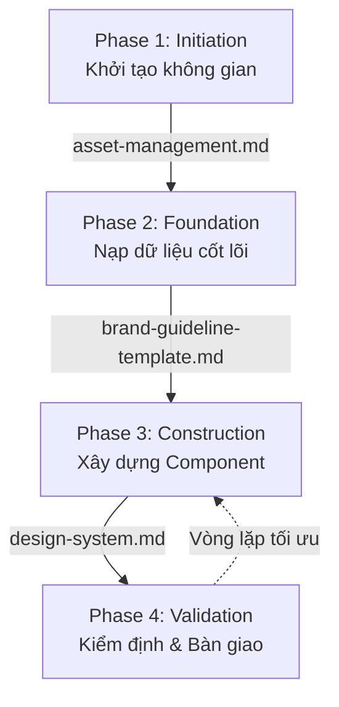

# Architecture Design Guideline
> Quy trình tiêu chuẩn kết hợp AI Agent với Hệ thống quản trị Thiết kế (Design Management System)

Tài liệu này hướng dẫn cách ứng dụng bộ 3 file cốt lõi (`asset-management.md`, `brand-guideline-template.md`, `design-system.md`) cùng với **AI Agent** để đảm bảo tính nhất quán, hiệu suất và khả năng mở rộng (scalability) ngay từ những bước đầu tiên của dự án.

---

## 🏗 Tổng quan Kiến trúc Quy trình (Workflow Architecture)

Sự kết hợp này vận hành theo 4 giai đoạn chính (Phases):

---

## 📋 Chi tiết từng Giai đoạn (Phases)

### Phase 0: Workspace Check (Kiểm tra Không gian Trước khi Bắt đầu)
**Mục tiêu:** Đảm bảo brand workspace đã có cấu trúc folder chuẩn trước khi tạo bất kỳ asset nào.
**File tham chiếu:** `ARCHITECTURE.md` (Section 3: Brand Workspace Standard)

1.  **Kiểm tra folder structure:** Verify brand workspace có đủ: `designs/assets/`, `designs/mockups/`, `designs/exports/`, `campaigns/`, `copy/emails/`, `copy/products/`, `reports/`.
    *   *Nếu thiếu:* Tạo theo chuẩn trong `ARCHITECTURE.md` Section 3.
2.  **Kiểm tra README.md:** Brand workspace phải có `README.md` với links đến brand guide và naming convention.
3.  **Kiểm tra asset-registry.md:** Mở `Designer Docs/asset-registry.md` → xem supplier specs cho product type đang làm.
    *   *Prompt mẫu:* "Trước khi bắt đầu design cho Kozmozracing, hãy check `ARCHITECTURE.md` Section 3 và verify folder `Kozmozracing/designs/` đã có đủ subfolders: assets, mockups, exports."

### Phase 0.5: POD-Specific Workflow (Áp dụng cho Vani Ecommerce)

Mapping từ workflow chung sang thực tế POD:

| Phase chung | Áp dụng POD | Output | Lưu ở đâu |
|-------------|------------|--------|-----------|
| **Phase 0: Workspace Check** | Verify brand folder structure | Confirmed OK | - |
| **Phase 1: Initiation** | Tạo design brief từ niche research | Brief doc | `CoworkOS/` (task brief) |
| **Phase 2: Foundation** | Load brand guide colors, fonts, specs | Design Tokens | Brand guide (đã có) |
| **Phase 3: Construction** | Tạo design → mockup → export theo supplier spec | PSD/AI/PNG files | `{Brand}/designs/assets/` → `mockups/` → `exports/` |
| **Phase 4: Validation** | Check supplier specs, naming convention, brand consistency | QA pass | Checklist trong `asset-management.md` |

**Sau khi hoàn thành:** Update asset count trong `Designer Docs/asset-registry.md` Section 2.

---

### Phase 1: Initiation (Khởi tạo Không gian Làm việc)
**Mục tiêu:** Xây dựng bộ khung lưu trữ và thiết lập quy tắc ban đầu để không file nào bị thất lạc.
**File tham chiếu:** `asset-management.md`

1.  **AI Action - Tạo thư mục:** Yêu cầu AI Agent đọc cấu trúc trong file và tự động tạo các biến môi trường hoặc thư mục vật lý (nếu là dự án code/web).
    *   *Prompt mẫu:* "Dựa theo `asset-management.md`, hãy sinh ra 1 script bash để tự động tạo cây thư mục thiết kế cho dự án mới tên là `New_App` của tôi."
2.  **AI Action - Kiểm soát tên file:** Thiết lập System Prompt cho AI để mọi lúc AI xuất file (VD: export css, script), nó đều phải bám theo nguyên lý naming convention ở file này.
    *   *Prompt mẫu:* "Gán nguyên tắc đặt tên file từ `asset-management.md` thành một rule cố định cho dự án này. Từ nay mọi ảnh hoặc component tạo ra đều phải theo chuẩn `[project]_[category]_[component]_[variant]_[version].[ext]`."

### Phase 2: Foundation (Nạp Dữ liệu Cốt lõi của Thương hiệu)
**Mục tiêu:** Chuyển hóa đặc tính thương hiệu (Màu, Font, Kích thước) thành giá trị số học (Design Tokens) cho AI.
**File tham chiếu:** `brand-guideline-template.md`

1.  **Thiết lập thực tế:** Bạn là người sẽ điền các mã màu HEX, tên Font, tỉ lệ typographic vào file `brand-guideline-template.md`.
2.  **AI Action - Tokenization:** AI sẽ dịch các thông số này thành các file cài đặt dự án (CSS Variables, Tailwind Config, SCSS, v.v.).
    *   *Prompt mẫu:* "Sau khi tôi cập nhật thông số màu vào `brand-guideline-template.md`, hãy bóc tách các mã màu Primary, Secondary và các mã màu Neutral, rồi tạo cho tôi một file `tailwind.config.js` chuẩn."
3.  **AI Action - Constraints:** Yêu cầu AI nhắc nhở hoặc từ chối tạo ra các đoạn code UI chứa những màu sắc ngoài bảng màu trên.

### Phase 3: Construction (Xây dựng Cấu trúc Giao diện)
**Mục tiêu:** Áp dụng phương pháp Atomic Design để xây dựng các mảnh ghép tái sử dụng được.
**File tham chiếu:** `design-system.md`

1.  **AI Action - Xây dựng Atoms/Molecules:** Bắt đầu tạo các component nhỏ nhất (VD: Buttons, Inputs) bằng cách nhắc AI áp dụng Design Tokens từ Phase 2 và quy định ở file Design System.
    *   *Prompt mẫu:* "Dựa trên tư duy Atomic Design trong `design-system.md` và mã màu từ `brand-guideline-template.md`, hãy code cho tôi một React Component `Button.tsx` gồm 3 variant (primary, secondary, ghost) và 3 size (sm, md, lg)."
2.  **AI Action - Xây dựng Organisms/Templates:** Lắp ráp các Molecules thành các cụm lớn hơn (VD: Navbar, Form, Card).
    *   *Prompt mẫu:* "Tôi cần xây dựng một `ProductCard` (Organism). Hãy lấy các component Button và Badge mà bạn đã code trước đó, lắp ghép lại làm sao để tuân thủ mọi nguyên lý từ `design-system.md`."

### Phase 4: Validation & Handoff (Kiểm định Chất lượng)
**Mục tiêu:** Đảm bảo sản phẩm hoàn thiện đúng chuẩn trước khi handover (giao cho dev, hoặc xuất file in).
**File tham chiếu:** Cả 3 file (phần Checklist).

1.  **AI Action - Review UI (dùng skill `ui-visual-validator`):**
    *   *Prompt mẫu:* "Là người kiểm duyệt, hãy sử dụng skill `ui-visual-validator` và đọc cả 3 file tài liệu của tôi. Dò lại đoạn code / thiết kế này xem tôi có vi phạm quy tắc 'Hơi thở thương hiệu' ở `design-system.md` hoặc dùng sai hệ màu trong `brand-guideline-template.md` hay không?"
2.  **AI Action - Checklist bàn giao:**
    *   *Prompt mẫu:* "Chạy checklist bàn giao file trong `asset-management.md`. Nhắc tôi những thứ bắt buộc phải kiểm tra (outline font, định dạng image...) trước khi gửi lên Production."

---

## ⚡ Tóm tắt Lên Mệnh lệnh cho AI (Summary of AI Delegation)

Nếu muốn AI Agent thật sự là một người hỗ trợ đắc lực ngay khi bắt đầu dự án, bạn có thể gửi cho AI một câu **System Kick-off Prompt** bao quát như sau:

> *"Chào AI Agent. Chúng ta bắt đầu dự án thiết kế mới. Nhiệm vụ đầu tiên của bạn là đọc và ghi nhớ 3 file nền tảng: `asset-management.md`, `brand-guideline-template.md`, và `design-system.md` (bao gồm cả tư duy Atomic Design và Design Tokens). Từ lúc này trở đi, tuyệt đối không tạo tên biến, css token, tên file, hay component nào mà văng ra khỏi chuẩn mực của 3 tài liệu này. Hãy đóng vai trò người giám sát kiến trúc thiết kế và báo ngay cho tôi nếu tôi yêu cầu thứ gì đó vi phạm."*
